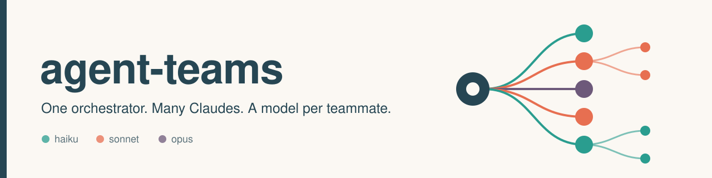
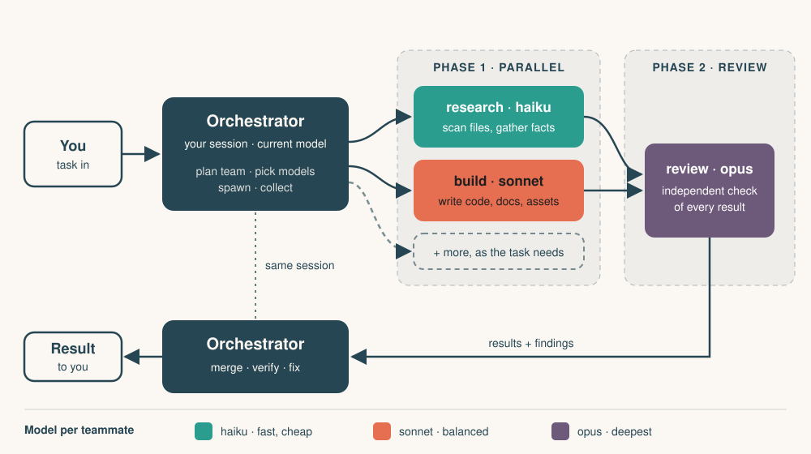

<p align="center">
  
</p>

<p align="center"><b>English</b> | <a href="README.de.md">Deutsch</a></p>

<p align="center">
  <a href="LICENSE"></a>
  
</p>

# agent-teams

A Claude skill that turns your current session into the orchestrator of a team of subagents, where every team member runs on its own model: `haiku`, `sonnet` or `opus`.

> This is a community skill. It is not made by Anthropic and not an official product. The skill is written in English and works no matter which language you write in; it replies in yours.

## Features

- **Per-member model choice.** Cheap `haiku` for bulk work, `sonnet` as the default, `opus` for architecture and critical review.
- **Parallel where possible.** Independent members start in the same turn; dependent members start once their predecessors have finished.
- **Safe parallel writing.** Members that write at the same time get separate files or Git worktrees.
- **Independent review.** A reviewer that did not do the work checks the result. The orchestrator verifies claims, fixes medium and severe findings itself and re-runs the tests.
- **You stay in control.** If you name roles and models, they are used as given. Otherwise the skill proposes a team and shows it as a short table first.

## How it works

<p align="center">
  
</p>

1. **Plan.** The orchestrator clarifies the goal and designs the team: role, model, agent type, task and dependencies per member.
2. **Spawn.** Independent members are started in parallel with the `Agent` tool, each with a self-contained briefing. Dependent members follow later and receive their predecessors' results.
3. **Collect.** Reports arrive as notifications. Members that need to improve something are continued with `SendMessage`, which keeps their context.
4. **Verify and deliver.** The orchestrator spot-checks claims, resolves contradictions, fixes reviewer findings and delivers the result plus one or two sentences on who contributed what.

The orchestrator is the session you are in and runs on the model currently selected there. A skill cannot change that model. If you want a different orchestrator, switch the session first (in Claude Code with `/model`).

Subagents cannot start subagents of their own, so the skill has to run in the main session. Nested teams are built flat by the orchestrator.

## Install

**Claude Code**

Copy the folder `skill/agent-teams` to one of these locations:

```bash
# personal (all projects)
cp -r skill/agent-teams ~/.claude/skills/agent-teams

# or per project
mkdir -p .claude/skills
cp -r skill/agent-teams .claude/skills/agent-teams
```

**Claude app**

[Download `agent-teams.skill`](https://github.com/Sausagedev07/agent-teams/raw/main/dist/agent-teams.skill) (also in [`dist/`](dist/agent-teams.skill)) and upload it in the app's skill settings.

> **Requirement:** the skill needs an environment where the main session has the `Agent` tool with a `model` parameter (e.g. Claude Code). Without it, the skill only proposes a team plan and does the work itself.

## Usage

Call the skill with a task, or just describe the team you want:

```text
/agent-teams Compare three static site generators for a docs site.
```

```text
Bau mir ein Team: drei Rechercheure mit haiku, ein Reviewer mit opus, am Ende ein kurzer Bericht von dir.
```

```text
Build a team for a small Python CLI: one plans (opus), two implement in separate files (sonnet), one writes tests, one reviews.
```

If you do not name models, the skill picks them with the guide below and tells you which ones it chose.

## Model guide

| Model | Use it for |
|---|---|
| `haiku` | Fast, simple, clearly scoped work: sifting files, collecting data, formatting, bulk tasks |
| `sonnet` | Default for implementation, research with analysis, tests, documentation |
| `opus` | Hard reasoning: architecture, tricky debugging, critical review |

More members are not automatically better. Split the work only when the parts are truly independent or when a second, unbiased view (review) adds something. Two to five members are enough for almost any task. Ready-made line-ups (research, development, writing, code review, bulk work) are in [`skill/agent-teams/references/team-examples.md`](skill/agent-teams/references/team-examples.md).

## Benchmarks

Three test cases, run on 2026-10-26 with Sonnet 5.5 as orchestrator. Each configuration was run **once (n=1)**, so there is no variance estimate. The baseline is a single subagent given the same prompt without the skill. A subagent has no `Agent` tool, so the baseline cannot spawn a team and plays all roles itself. The runs used the original German version of the skill (v1.0.0); v1.1 is an English translation with the same instructions and has not been re-benchmarked.

**Criteria met** (assertions per test case)

| Case | With skill | Baseline (single agent) |
|---|---|---|
| Research team (balcony solar power, Germany) | 5/5 | 1/5 |
| Dev team (Python CLI todo tool) | 5/5 | 2/5 |
| Bulk sorting (40 products, 4 categories) | 4/4 | 1/4 |
| **Total** | **14/14** | **4/14** |

Read this score with care: most assertions check team behavior (right models, parallel start, order), so a single agent fails them by construction. The score shows that the skill makes real teams happen, not that a single agent writes worse text.

<p align="center">
  
</p>

**Time and tokens**

Time is in seconds. "Critical path" is the sum over phases of the slowest member in each phase; it ignores orchestrator overhead between phases. "Team sum" adds up all members.

| Case | Baseline | Team, critical path | Team, sum |
|---|---|---|---|
| Research team | 56.5 | 257.4 | 393.0 |
| Dev team | 35.8 | 128.0 | 148.4 |
| Bulk sorting | 20.6 | 24.8 | 56.1 |

| Case | Tokens, team | Tokens, baseline | Ratio |
|---|---|---|---|
| Research team | 344,049 | 74,508 | 4.6x |
| Dev team | 339,592 | 70,120 | 4.8x |
| Bulk sorting | 336,953 | 68,863 | 4.9x |

Token counts are as reported by the harness and include each agent's fixed system-prompt overhead (about 55-65k). The orchestrator's own tokens were not measured, so the real team cost is higher.

<p align="center">
  
</p>

<p align="center">
  
</p>

**Honest conclusion.** In these runs a team is more expensive (about 4.6-4.9x the tokens) and not faster. Where it paid off is independent checking, which found real errors:

- The Opus checker in the research case corrected a payback period from 3.4-4.3 years to 4-8 years and found that a claimed legal deadline is not in the law. (These were errors of the haiku researchers; it was not checked whether the baseline made the same ones.)
- The Opus reviewer in the dev case found two medium issues: a traceback on write errors, and a test that did not test its own promise. The orchestrator fixed both; the suite went from 26 to 28 passing tests.

Full report: [`benchmarks/benchmark.md`](benchmarks/benchmark.md). Raw data: [`benchmarks/raw-data.json`](benchmarks/raw-data.json). Chart script: [`benchmarks/make_charts.py`](benchmarks/make_charts.py).

## When (not) to use

Use it when:

- the task splits into parts that are really independent (several research questions, separate modules, bulk items);
- you want a second pair of eyes that did not do the work (review, fact-check, cross-check);
- different parts deserve different models, for example cheap workers and one strong reviewer.

Skip it when:

- the task is small or sequential, so one session does it faster and cheaper;
- you need the fastest answer: in the benchmarks the team was slower than a single agent;
- token cost matters more than an independent check.

## Repository layout

```text
skill/agent-teams/
  SKILL.md                      the skill (English)
  assets/team-template.md       reusable team template
  references/team-examples.md   ready-made team line-ups
dist/agent-teams.skill          packaged skill for the Claude app
evals/                          3 test cases in claude-plugin-eval format
examples/
  research-team/
  dev-team/
  bulk-sorting/
benchmarks/                     benchmark.md, raw-data.json, make_charts.py
docs/img/                       banner, architecture diagram, charts
LICENSE                         MIT
```

## Limitations

- Subagents cannot spawn subagents. Run the skill in the main session; if it runs inside a subagent, it can only propose a team plan.
- The orchestrator model cannot be changed by the skill. Switch the session model yourself.
- Only `haiku`, `sonnet` and `opus` are used. Other model names are mapped to the nearest tier.
- The benchmark is small (3 cases, n=1) and mostly measures team behavior. Treat the numbers as an indication, not as proof.
- Cost grows with team size and model choice. Use strong models only where they visibly help.

## License

[MIT](LICENSE)
