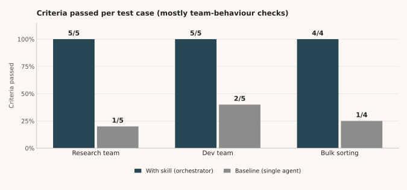
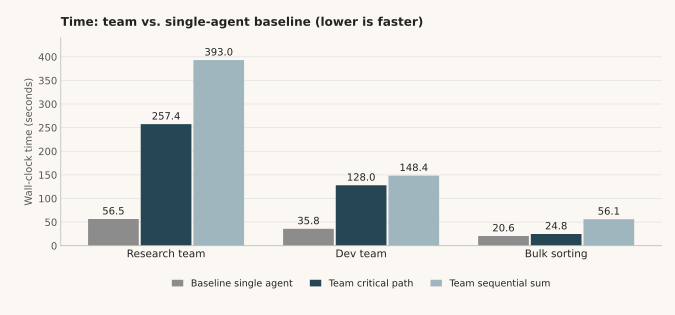
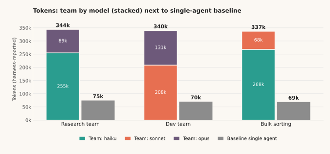

# Benchmark: orchestrator team vs. single agent

Measured on 2026-10-26 with three test cases. Orchestrator: the main session (claude-sonnet-5-5). All numbers below are computed from [`raw-data.json`](raw-data.json); [`make_charts.py`](make_charts.py) regenerates the charts.

## Summary

- **The team scored 14/14 criteria, the baseline 4/14.** Read this with the caveat below: most criteria check team behaviour (right models, parallel start, order), so a single agent fails them by construction.
- **The team costs about 5x the tokens** (4.6x to 4.9x per case, 4.8x overall: 1,020,594 vs. 213,491 tokens).
- **In these cases the team is not faster.** Critical path was 1.2x to 4.6x the baseline's wall-clock time, and the sequential sum was 2.7x to 7.0x. The tasks were small, and each extra agent adds start-up and system-prompt overhead.
- **The benefit is a real role split and independent checking.** In the research case the opus checker corrected the payback period (3.4-4.3 years became 4-8 years), found a claimed 4-month meter-swap deadline that is not in the law, and corrected "one device per household". In the dev case the reviewer found two medium issues (a traceback on write errors; a test that did not test its own claim), and both were fixed.
- **No evidence about text quality.** With n=1 and checks that favour the team, this benchmark does not show that team output is better than a single agent's output in general.

## Methodology

| | |
|---|---|
| With skill | The main session loaded the skill and acted as orchestrator. It spawned subagents with the Agent tool and a per-member `model` parameter. |
| Baseline | One general-purpose subagent got the same prompt without the skill. Subagents have no Agent tool, so the baseline could not spawn a team and played all roles itself. |
| Sample size | 1 run per configuration per case (n=1). No variance estimate. |
| Tokens | As reported by the harness per subagent. They include each agent's fixed system-prompt overhead (about 55-65k), which is why even tiny tasks show 55k+ tokens. The orchestrator's own tokens were **not** measured, so the real team cost is higher than shown. |
| Critical path | Sum over phases of the slowest member in that phase. It ignores orchestrator overhead between phases. |
| Sequential sum | Sum of all team members' durations, as if run one after another. |

**Caveat.** Most assertions check team behaviour: which models were started, whether members started in parallel, and the order of phases. The baseline fails these by construction. The score shows that the skill makes real teams happen, not that a single agent produces worse text. Where an assertion checks the result itself (report exists, tool works, 40 items sorted), the baseline passed it in every case.

The test prompts were written in German; assertions are translated here. The runs used the original German version of the skill (v1.0.0); the English translation (v1.1) has the same instructions and has not been re-benchmarked.

## Scores

Criteria passed (passed/total):

| Test case | With skill (orchestrator) | Baseline (single agent) |
|---|---|---|
| Research team | 5/5 | 1/5 |
| Dev team | 5/5 | 2/5 |
| Bulk sorting | 4/4 | 1/4 |
| **Total** | **14/14** | **4/14** |



## Time and tokens: team vs. baseline

Factor = team value divided by baseline value (above 1.0 means the team used more).

| Test case | Baseline time | Team critical path | Factor | Team sequential sum | Factor | Baseline tokens | Team tokens | Factor |
|---|---|---|---|---|---|---|---|---|
| Research team | 56.5 s | 257.4 s | 4.6x | 393.0 s | 7.0x | 74,508 | 344,049 | 4.6x |
| Dev team | 35.8 s | 128.0 s | 3.6x | 148.4 s | 4.1x | 70,120 | 339,592 | 4.8x |
| Bulk sorting | 20.6 s | 24.8 s | 1.2x | 56.1 s | 2.7x | 68,863 | 336,953 | 4.9x |
| **Total** | 112.8 s | 410.2 s | 3.6x | 597.5 s | 5.3x | 213,491 | 1,020,594 | 4.8x |

Team tokens by model:

| Test case | haiku | sonnet | opus |
|---|---|---|---|
| Research team | 255,010 | - | 89,039 |
| Dev team | - | 208,425 | 131,167 |
| Bulk sorting | 268,474 | 68,479 | - |





Why the team is slower here: parallelism only helps when members run long enough that waiting dominates. In the bulk-sorting case, the four haiku workers took 8.5-13.4 s each, so the phase was short, but the second phase (check) then added another 11.4 s on top. Phases that depend on earlier phases (plan, build, test, review; or research, then check) cannot overlap, which is the point of independent checking but also what limits speed.

## Test case 1: Research team (balcony solar power plants in Germany)

Prompt (translated): three agents research one aspect each of "pros and cons of balcony solar power plants in Germany" in parallel (cost, law/registration, yield). The researchers should be haiku; a fourth agent on opus checks the results. At the end the user wants a short report. Models specified by the user: yes.

| role | model | phase | tokens | seconds | tool uses |
|---|---|---|---|---|---|
| recherche-kosten | haiku | 1 | 79,467 | 51.2 | 12 |
| recherche-recht | haiku | 1 | 84,665 | 84.4 | 18 |
| recherche-ertrag | haiku | 1 | 90,878 | 99.9 | 21 |
| gegenpruefer | opus | 2 | 89,039 | 157.5 | 26 |
| *Baseline (single agent)* | - | - | 74,508 | 56.5 | 9 |

notable_findings:

- Opus checker corrected the payback period from 3.4-4.3 years to 4-8 years
- Checker found that a claimed 4-month meter-swap deadline is not in the law (§ 10a EEG)
- Checker corrected "one device per household" (law allows several devices within the limits)

Assertions:

| Assertion | With skill | Baseline |
|---|---|---|
| Three researchers were started with model haiku | pass | fail |
| The three researchers were started in the same turn (parallel) | pass | fail |
| A fourth agent with model opus checks the researchers' results | pass | fail |
| The opus checker was started only after the researchers and received their results in its prompt | pass | fail |
| bericht.md summarises cost, law/registration and yield | pass | pass |

## Test case 2: Dev team (Python CLI todo tool)

Prompt (translated): a small Python CLI todo tool (add/list/done, JSON file). Make it a team: one plans, two implement (separate files), one tests, a review at the end. Choose sensible models and say which. Models specified by the user: no.

| role | model | phase | tokens | seconds | tool uses |
|---|---|---|---|---|---|
| planer | opus | 1 | 55,303 | 25.5 | 2 |
| umsetzer-a (storage.py) | sonnet | 2 | 67,153 | 20.4 | 2 |
| umsetzer-b (cli.py) | sonnet | 2 | 67,947 | 23.6 | 5 |
| tester | sonnet | 3 | 73,325 | 32.9 | 4 |
| reviewer | opus | 4 | 75,864 | 46.0 | 3 |
| *Baseline (single agent)* | - | - | 70,120 | 35.8 | 4 |

notable_findings:

- Reviewer found 2 medium issues: write errors ended in a traceback; a test named "id never reused" did not test that promise
- Orchestrator fixed both; test suite grew from 26 to 28 passing tests

Assertions:

| Assertion | With skill | Baseline |
|---|---|---|
| The answer names the chosen model for each role | pass | fail |
| Two implementers were started in parallel and got separate files | pass | fail |
| Order: planner, then implementers, then tester, then reviewer | pass | fail |
| The todo tool supports add, list and done with a JSON file and runs without errors | pass | pass |
| The orchestrator verified the result itself (ran code or read files) | pass | pass |

Baseline evidence: it named planned models but used none, played all roles one after another, and ended with 6 passing tests (the team: 28).

## Test case 3: Bulk sorting (40 products into 4 categories)

> **Note on the test data:** all descriptions in `produkte.txt` are the same placeholder ("kurze Beschreibung"), and the 40 lines repeat 16 product names (e.g. Wasserkocher, Toaster). The task is therefore easy; assignment rests on product names alone.


Prompt (translated): sort 40 short product descriptions into 4 categories (kitchen, garden, sports, office), then have them critically checked for errors again. Use an agent team. Models specified by the user: no.

| role | model | phase | tokens | seconds | tool uses |
|---|---|---|---|---|---|
| sortierer-1 (1-10) | haiku | 1 | 66,722 | 8.5 | 4 |
| sortierer-2 (11-20) | haiku | 1 | 67,919 | 11.9 | 4 |
| sortierer-3 (21-30) | haiku | 1 | 66,592 | 10.8 | 3 |
| sortierer-4 (31-40) | haiku | 1 | 67,241 | 13.4 | 4 |
| pruefer | sonnet | 2 | 68,479 | 11.4 | 2 |
| *Baseline (single agent)* | - | - | 68,863 | 20.6 | 3 |

notable_findings:

- All 40 items assigned exactly once (11/9/11/9)
- Sonnet checker found no errors and confirmed the 3 borderline items

Assertions:

| Assertion | With skill | Baseline |
|---|---|---|
| Agents with haiku or sonnet do the sorting | pass | fail |
| A stronger model than the workers (sonnet or opus) does the critical check | pass | fail |
| The answer names which models were chosen | pass | fail |
| einsortiert.md assigns all 40 products to exactly one of the 4 categories | pass | pass |

In this case the checker found nothing to correct, so the independent check added about 11 s and 68k tokens without changing the result.

## Reproduce

```bash
cd benchmarks
python3 make_charts.py   # needs matplotlib; writes ../docs/img/chart-*.svg
```
